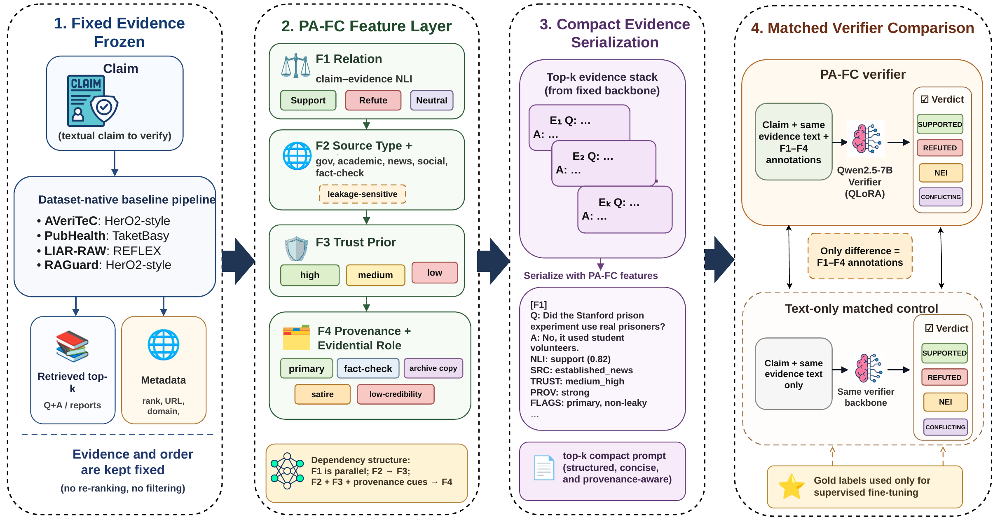

# PA-FC: Provenance-Aware Fact Checking

Code and data for **“Relevance Is Not Admissibility: When Does Source Conditioning Help Web Fact Verification?”** (WSDM ’27).

Web retrieval identifies evidence relevant to a claim, but relevance alone does not establish whether a source is suitable for deciding the claim. **Provenance-Aware Fact Checking (PA-FC)** studies this distinction through a fixed-evidence framework: it keeps the retrieved evidence and its order unchanged while attaching compact, interpretable descriptions to each item for the verifier.



## Method overview

PA-FC augments every evidence item with four dependent information groups, without reranking, filtering, or adding new evidence.

| Feature | Description | Example representation |
|---|---|---|
| **F1: Claim–evidence relation** | Whether the item supports, refutes, or is neutral to the claim | `NLI: support (0.82)` |
| **F2: Source family and leakage sensitivity** | The source type and potential exposure to a previously adjudicated verdict | `SRC: established_news` |
| **F3: Source-level trust prior** | A coarse trust level derived from the source description | `TRUST: medium_high` |
| **F4: Provenance and evidential role** | Item-level role and visible cautionary cues | `PROV: strong`, `FLAGS: primary` |

An evidence item is serialized into a compact description:

```text
[E1]
Q: Did the Stanford prison experiment use real prisoners?
A: No, it used student volunteers.
NLI: support (0.82) | SRC: established_news | TRUST: medium_high | PROV: strong | FLAGS: primary, non-leaky
```

The verifier receives the same evidence text as the evidence-only comparison, with the additional PA-FC description. The experiments use **Qwen2.5-7B-Instruct** and **Llama-3.1-8B-Instruct** with QLoRA fine-tuning.

## Main results

The following values are reported in **Table 5 of the paper**. **(P)** identifies a published reference result and **(R)** a reproduced reference pipeline. Dashes indicate metrics not reported for that reference.

| Dataset | System | Macro-F1 | Acc. |
|---|---|---:|---:|
| **AVeriTeC** | (P) HerO2 [38] | 0.38 | 0.68 |
| | (R) HerO2 | 0.37 | 0.68 |
| | **PA-FC + Qwen2.5** | **0.45** | **0.70** |
| | PA-FC + Llama-3.1 | 0.44 | 0.69 |
| **PubHealth** | (P) TakeItEasy [36] | 0.71 | 0.83 |
| | (R) TakeItEasy | 0.75 | 0.84 |
| | **PA-FC + Qwen2.5** | **0.79** | **0.86** |
| | PA-FC + Llama-3.1 | 0.76 | 0.85 |
| **RAGuard** | (P) RAGuard (Misleading) [39] | – | 0.46 |
| | (R) HerO2 | 0.46 | 0.55 |
| | PA-FC + Qwen2.5 | 0.66 | 0.66 |
| | **PA-FC + Llama-3.1** | **0.67** | **0.67** |
| **LIAR-RAW** | (P) REFLEX, 855-item subset [17] | 0.51 | – |
| | (R) REFLEX, 1,251 items | 0.37 | 0.45 |
| | **PA-FC + Qwen2.5** | **0.47** | **0.51** |
| | PA-FC + Llama-3.1 | 0.46 | 0.47 |

The paper additionally reports controlled evidence-only comparisons and analyzes when source conditioning is beneficial. The table above should not be interpreted as a matched estimate of conditioning gains for every baseline.

### Reproduced in this repository

Recomputed from per-claim prediction files by `scripts/report_results.py`. No
paper value is hardcoded anywhere in this repository.

The paper's PA-FC rows are means over seeds {42, 191, 999}. The rows below are
**single runs**, each from the best-performing seed for that cell, so one
training run reproduces one row. The seed is named so every number is
independently checkable.

| Dataset | System | Seed | Macro-F1 | Acc. | Paper |
|---|---|---:|---:|---:|---:|
| AVeriTeC | PA-FC + Qwen2.5 | 42 | 0.4564 | 0.7120 | 0.45 / 0.70 |
| AVeriTeC | PA-FC + Llama-3.1 | 999 | 0.4822 | 0.6860 | 0.44 / 0.69 |
| PubHealth * | PA-FC + Qwen2.5 | 191 | 0.7928 | 0.8652 | 0.79 / 0.86 |
| PubHealth * | PA-FC + Llama-3.1 | 999 | 0.7608 | 0.8570 | 0.76 / 0.85 |
| RAGuard | PA-FC + Qwen2.5 | 191 | 0.6690 | 0.6729 | 0.66 / 0.66 |
| RAGuard | PA-FC + Llama-3.1 | 191 | 0.6729 | 0.6729 | 0.67 / 0.67 |
| LIAR-RAW † | PA-FC + Qwen2.5 | 42 | 0.4736 | 0.5100 | 0.47 / 0.51 |

\* PubHealth trains under the TakeItEasy CausalLM pipeline, not LLaMA-Factory,
and conditions on a claim-level aggregated summary carrying F1, F3 and F4 but
not F2. See [`takeiteasy/README.md`](takeiteasy/README.md). Training the same
claims as per-evidence LLaMA-Factory prompts scores far lower, so the two are
not interchangeable.

† LIAR-RAW trains under REFLEX, whose `llmzoo` package is not vendored here
because upstream ships no license. `scripts/train_liar_raw.sh` prints the clone
command if it is missing.

Six of the seven land within 0.01 Macro-F1 of the paper. AVeriTeC with
Llama-3.1 reads higher (0.48 against 0.44) because a single best seed is not a
three-seed mean; that cell's seeds span 0.4526 to 0.4822.

Two gaps are left visible rather than filled. PubHealth has no seed-42 run in
the same pipeline, since seeds 191 and 999 were trained with TakeItEasy's
CausalLM pipeline while seed 42 used LLaMA-Factory, and averaging across two
trainers would hide an implementation difference. LIAR-RAW with Llama-3.1 has no
valid run: every attempt produced an empty adapter, so the row is absent here
instead of being reported from a broken checkpoint.

## Quick start

```bash
git clone https://github.com/gauravkumar62024/PA-FC-Provenance-Aware-Fact-Checking.git
cd PA-FC-Provenance-Aware-Fact-Checking
conda env create -f environment.yml
conda activate pafc
bash scripts/check_environment.sh
bash scripts/prepare_data.sh
```

The prepared datasets are described in [`data/README.md`](data/README.md). Check their original licenses before redistribution.

Training from `data/` needs no model download beyond the backbone. Only stage 1
of the feature pipeline does: it fetches `cross-encoder/nli-deberta-v3-large`
(about 1.6 GB) from Hugging Face on first use. Allow network access for that
run, or pre-fetch the model, otherwise stage 1 fails with a cache-miss error
when `HF_HUB_OFFLINE=1` is set.

### Training

AVeriTeC, PubHealth, and RAGuard use [LLaMA-Factory](https://github.com/hiyouga/LLaMA-Factory). Set up its dataset configurations using:

```bash
bash llamafactory/setup.sh /path/to/LLaMA-Factory
```

See [`llamafactory/README.md`](llamafactory/README.md) for setup details and dataset registration. For example, from the LLaMA-Factory checkout:

```bash
llamafactory-cli train examples/train_lora/pafc/qwen/averitec_pafc.yaml
llamafactory-cli train examples/train_lora/pafc/llama/averitec_pafc.yaml
```

LIAR-RAW uses the REFLEX-based trainer. See the training scripts and configurations in [`scripts/`](scripts/) and [`configs/train/`](configs/train/).

### Inference and evaluation

```bash
python scripts/infer_averitec.py --config configs/train/qwen/averitec_pafc.yaml \
       --test_file data/averitec/eval.json --adapter_dir saves/... --out_dir preds/...

cp configs/runs.example.json configs/runs.json
python scripts/report_results.py --runs configs/runs.json --csv results.csv
```

### Feature preparation

To build PA-FC descriptions from a dataset's original retrieved evidence:

```bash
bash scripts/run_pipeline.sh --dataset averitec --split train \
     --retrieval data/raw/averitec/train_retrieval_top_k_with_idx.json \
     --qa data/raw/averitec/train.json \
     --out work/averitec
```

The pipeline computes the claim–evidence relation, source classification, source-level trust prior, and item-level provenance/evidential-role descriptors, then prepares the training format. See [`docs/PIPELINE.md`](docs/PIPELINE.md).

## Environment

| Purpose | Python | PyTorch | Transformers | tldextract |
|---|---|---|---|---|
| Feature generation (F1–F4) | 3.10 | 2.6.0+cu124 | 5.12.1 | 5.3.1 |
| QLoRA training and inference | 3.11 | 2.12.0+cu130 | 5.6.0 | 3.2.0 |

The evaluated setup uses 4-bit QLoRA, LoRA rank 16, alpha 32, dropout 0.05, three training epochs, and a 4,096-token context limit. Dataset-specific configurations are provided in [`configs/train/`](configs/train/).

## Repository structure

```text
configs/        Feature inventories and training configurations
data/           Dataset preparation and related files
docs/           Pipeline and dataset documentation
llamafactory/   LLaMA-Factory integration
results/        Evaluation artifacts
scripts/        Feature preparation, training, inference, and evaluation
src/            PA-FC implementation
tests/          Unit tests
```

Run tests with:

```bash
pytest tests/ -q
```

## Citation and license

See [`CITATION.cff`](CITATION.cff) for citation information. The repository declares an MIT license. Training integration relies on [LLaMA-Factory](https://github.com/hiyouga/LLaMA-Factory) (Apache-2.0). Datasets derived from third-party corpora remain subject to their original terms; consult [`data/README.md`](data/README.md).
